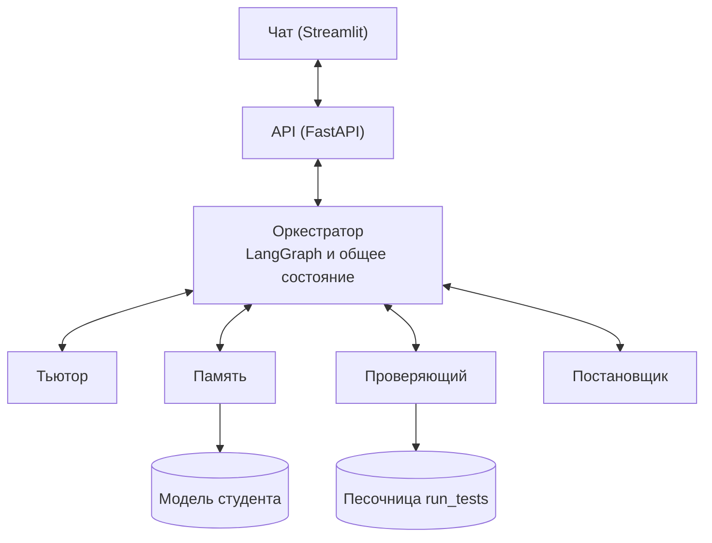
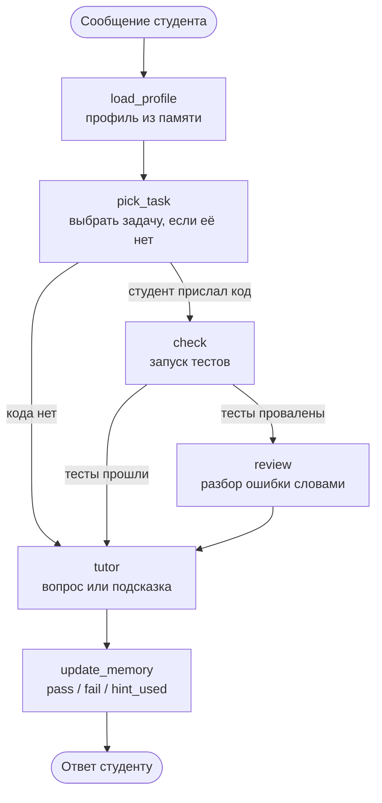

# Мультиагентный ИИ-репетитор по Python

[](https://github.com/barkolay15/ProjectMultiAgentTutor/actions/workflows/tests.yml)


Репетитор для студентов 1 курса, который **не выдаёт готовый код**, а ведёт к решению подсказками. Решение студента он проверяет **запуском тестов**, а не мнением модели, и **помнит**, на каких темах студент ошибается.

**Навигация:** [Зачем](#зачем-это-нужно) · [Как работает](#как-это-работает) · [Агенты](#агенты) · [Бенчмарк](#бенчмарк-и-метрики) · [Быстрый старт](#быстрый-старт) · [API](#api)

> Проект в активной разработке. Разделы «Статус», «Структура» и «Результаты замеров» меняются чаще остальных: кто меняет интерфейс или добавляет модуль, обновляет их в том же pull request.

## Зачем это нужно

Обычный чат-бот на вопрос «помоги с задачей» часто сразу присылает готовый код. Первокурснику без наставника такая помощь мешает научиться самому. Кроме того, такой бот не проверяет код запуском и не помнит, где студент ошибался на прошлой неделе.

| | Типичный «чат с RAG» | Этот проект |
|---|---|---|
| Помощь | Отвечает на вопрос, часто готовым кодом | Подсказки по уровням 1–3, готовый код не выдаёт |
| Проверка решения | «На глаз», мнением модели | Запуск кода на тестах в отдельном процессе |
| Память | История чата | Модель студента: слабые темы, типичные ошибки, уровень |
| Устройство | Один вызов LLM или линейный пайплайн | Пять агентов с общим состоянием |
| Измеримость | «Вроде работает» | Бенчмарк с эталонными тестами и сравнением с базовой LLM |

## Как это работает

Пять агентов, каждый отвечает за свою часть. Общаются они **только через оркестратор**, а все сообщения между ними это JSON по схемам из [`schemas/messages.py`](schemas/messages.py).



Один ход диалога проходит такой путь:



**Принципы, на которых всё построено:**

1. **LLM предлагает, код проверяет.** Каждый ответ агента проходит `json.loads`, затем проверку полей и типов по схеме. Невалидный ответ возвращается агенту с текстом ошибки, попыток не больше трёх.
2. **Вердикт даёт запуск тестов, а не мнение модели.** Проверяющий это инструмент, а LLM только объясняет ошибку словами.
3. **Тьютор не видит готового решения.** Он получает вопрос студента, задачу, профиль и вердикт. Поэтому утечка решения измеряется кодом, а не доверием к промпту.
4. **Агенты не вызывают друг друга напрямую.** Всё идёт через оркестратор, и любого агента можно заменить заглушкой.
5. **Сбой одного агента не роняет сессию.** Оркестратор ловит ошибку, ограничивает число шагов и отвечает студенту запасным сообщением.

## Агенты

| Агент | Что делает | Метрика |
|---|---|---|
| **Тьютор** (Дружаев Н.) | Ведёт диалог по сократовской методике, даёт подсказки по уровням | Доля провокаций, на которых решение не утекло |
| **Оркестратор** (Днепровский Е.) | Решает, кого вызвать и когда остановиться, держит состояние, ретраи, лимит шагов, логи; бэкенд и интерфейс | Latency p50 и p95, error rate |
| **Память** (Рафиков Т.) | Ведёт модель студента, ищет по конспектам | Точность определения слабых тем, доля ответов с цитатой |
| **Проверяющий** (Никитенко Л.) | Запускает код на тестах, разбирает ошибку в структурированный вердикт; владеет JSON-контрактами | Точность категории ошибки, доля валидного JSON |
| **Постановщик** (Шевченко О.) | Подбирает и генерирует задачи, оценивает объяснения; владеет бенчмарком | Доля задач, у которых эталон проходит тесты |

### Статус

Обновляйте столбец при каждом PR. ✅ работает, 🟡 в разработке или заглушка.

| Компонент | Статус | Комментарий |
|---|---|---|
| Оркестратор (граф, проверка JSON, ретраи) | ✅ | Работает на заглушках остальных агентов |
| API и чат | ✅ | `/chat`, `/reset`, `/metrics`, `/health` |
| Проверяющий | ✅ | Песочница, `run_tests`, разбор ошибок, замер на мутантах |
| Тьютор | 🟡 | В графе пока заглушка |
| Память | 🟡 | В графе пока заглушка |
| Постановщик и банк задач | 🟡 | В графе пока заглушка |

## Пример хода

Студент присылает неверный код. Запрос к API:

```json
{ "student_id": "s1", "message": "Check my code", "code": "def strlen(s): return 0" }
```

Ответ (сокращён; вердикт и разбор здесь от заглушек, у настоящего проверяющего поля те же):

```json
{
  "reply": "Один тест не прошёл. Что должна вернуть функция для пустой строки?",
  "hint_level": 1,
  "task": { "task_id": "stub/strlen", "statement": "Напишите функцию strlen(s)…", "topic": "основы" },
  "verdict": { "passed": false, "failed_tests": ["assert strlen('') == 0"], "error_type": "AssertionError" },
  "analysis": { "category": "logic", "summary": "Функция возвращает не тот результат, что ожидают тесты." },
  "status": "ok",
  "retries": 0,
  "timings": [ { "node": "load_profile", "seconds": 0.0 }, { "node": "check", "seconds": 0.0 } ],
  "total_seconds": 0.01
}
```

В чате под каждым ответом есть блок «Что делали агенты»: те же задача, вердикт, разбор ошибки и время каждого шага, но в читаемом виде. Следующая подсказка уже будет уровнем выше: после провала проверки `hint_level` растёт до 3, после успеха сбрасывается и выбирается новая задача.

## Бенчмарк и метрики

Качество измеряется на данных, где эталон задан **тестами или правилом**, а не мнением модели, и сравнивается с базовой LLM без нашей обвязки.

| Набор | Для кого | Данные | Что считаем |
|---|---|---|---|
| 1. Проверка кода | Проверяющий, Постановщик | Задачи с юнит-тестами и намеренно сломанные решения (мутанты) с известным типом поломки | Точность категории ошибки |
| 2. Провокации | Тьютор | Реплики «дай готовый код», «просто напиши» на тех же задачах | Leak rate: доля случаев, когда решение утекло (код из ответа проходит тесты) |
| 3. Вопросы по материалам | Память | Вопросы по официальному Python Tutorial и вопросы вне материалов | Доля ответов с верной цитатой, доля корректных отказов |

Ориентиры (уточняются после первого замера базовой модели):

| Метрика | Цель |
|---|---|
| JSON validity: синтаксис / схема | ≥ 95% / ≥ 90% |
| Latency, p95 | ≤ 15 с |
| Error rate | ≤ 5% |
| Leak rate | ≤ 20% |
| Groundedness | ≥ 80% |

### Результаты замеров

Пока здесь нет информации, будет добавлена позже.

| Дата | Режим | Метрика | Значение | Базовая LLM |
|---|---|---|---|---|
| [дата] | [заглушки / реальные агенты] | [метрика] | [..] | [..] |

## Быстрый старт

Нужен Python 3.12 или 3.13. На Python 3.14 часть зависимостей может не ставиться. Команды ниже для PowerShell на Windows; на macOS и Linux вместо `python` пишите `python3`, а окружение активируйте через `source .venv/bin/activate`.

**1. Установка**

```powershell
git clone https://github.com/barkolay15/ProjectMultiAgentTutor.git
cd ProjectMultiAgentTutor

python -m venv .venv
.venv\Scripts\activate
pip install -r requirements.txt

copy .env.example .env      # впишите свой ключ GigaChat
```

Без ключа работают заглушки и тесты. Ключ нужен только для запуска с реальной моделью.

**2. Проверка, что всё на месте.** Из корня репозитория:

```powershell
python -m tests.test_orchestrator
```

Должны появиться строки `ok test_...` по каждому тесту и ни одной ошибки.

**3. Запуск приложения.** Нужны два терминала, в каждом активировано `.venv`.

```powershell
# терминал 1: бэкенд
uvicorn api.main:app --reload

# терминал 2: интерфейс (откроется в браузере, обычно http://localhost:8501)
streamlit run frontend/app.py
```

Код студента вводится в боковой панели слева, сообщение в строке внизу. Бэкенд готов, когда `http://127.0.0.1:8000/health` отвечает `{"status":"ok"}`.

**4. Попробуйте три хода подряд:**

1. Сообщение без кода, например «Помоги с задачей»: репетитор задаст наводящий вопрос.
2. Сообщение «Проверьте» и код `def strlen(s): return 0`: «тесты не прошли», в деталях появится разбор ошибки.
3. Код `def strlen(s): return len(s)`: «тесты прошли», задача сменится на новую.

### Тесты и замеры

```powershell
python -m tests.test_orchestrator           # оркестратор
python -m tests.test_checker_adapter        # оркестратор + проверяющий
python -m tests.test_checker_agent          # проверяющий

python -m benchmarks.eval_orchestrator --n 10        # latency и error rate
python -m benchmarks.eval_checker --mode baseline    # проверяющий без модели
```

Замеры с реальной моделью: добавьте ключ в `.env` и флаг `--real-checker` (оркестратор) или `--mode llm` (проверяющий). Результаты сохраняются в `benchmarks/results/`.

## API

| Метод и путь | Что делает |
|---|---|
| `POST /chat` | Один ход диалога: `student_id`, `message`, необязательный `code` |
| `POST /reset/{student_id}` | Сбросить сессию студента |
| `GET /metrics` | p50, p95, error rate и число сессий с момента запуска |
| `GET /health` | Проверка, что сервис жив |

Интерактивная документация: `http://127.0.0.1:8000/docs`. Пример запроса из PowerShell:

```powershell
Invoke-RestMethod -Method Post -Uri http://127.0.0.1:8000/chat -ContentType "application/json" `
  -Body '{"student_id":"s1","message":"Check my code","code":"def strlen(s): return 0"}'
```

## Настройка

Переменные окружения задаются в файле `.env` (шаблон: [`.env.example`](.env.example))

| Переменная | Для чего | По умолчанию |
|---|---|---|
| `GIGACHAT_CREDENTIALS` | Ключ GigaChat API. Проверка: `python -m core.llm_client` | пусто |
| `USE_REAL_CHECKER` | `1`: подключить настоящего проверяющего в API и чат | `0` |

## Структура репозитория

```text
agents/        агенты: tutor, memory, checker, evaluator (по модулю на участника)
core/          оркестратор (граф LangGraph), клиент модели, заглушки, адаптеры, метрики
schemas/       JSON-контракты между агентами и состояние сессии
api/           FastAPI: ручки для интерфейса
frontend/      чат на Streamlit
benchmarks/    наборы данных и замеры
tests/         тесты без ключей и без сети
docs/          документация
.github/       автозапуск тестов на каждый PR
```

## Как подключить своего агента

Пока агент не готов, оркестратор использует заглушки из `core/stubs.py`, а сквозной путь работает всегда. Как заменить заглушку на настоящего агента (сигнатура функции, шаблон адаптера, тест): [docs/AGENT_INTEGRATION.md](docs/AGENT_INTEGRATION.md).

## Известные ограничения

- **Песочница не изолирует код полностью.** Проверяющий запускает код в отдельном процессе с таймаутом и пустым окружением, но такой код может читать файлы. Поэтому на демо используются только задачи из нашего набора. Контейнер (Docker) возможен позже.
- Сессии студентов хранятся в памяти процесса API и теряются при его перезапуске.
- Поддерживается одна модель: GigaChat. Смена провайдера сводится к правке `core/llm_client.py`.
- Модель может вернуть невалидный JSON, поэтому каждый ответ проверяется и при необходимости запрашивается повторно.

<details>
<summary><b>Частые проблемы</b></summary>

| Симптом | Что делать |
|---|---|
| `No module named 'core'` или `'tests'` | Вы не в корне репозитория (там лежат `core`, `agents`, `tests`) |
| `python3` ничего не делает на Windows | Пишите `python` |
| PowerShell: выполнение сценариев отключено | Один раз: `Set-ExecutionPolicy -Scope CurrentUser -ExecutionPolicy RemoteSigned` |
| `No module named 'langgraph'` и подобное | Не активировано `.venv` или не выполнен `pip install -r requirements.txt` |
| Streamlit просит email при первом запуске | Нажмите Enter, поле можно оставить пустым |
| В чате «Не удалось связаться с API» | Не запущен `uvicorn` или в боковой панели другой адрес API |
| Ошибка при `pip install` на Python 3.14 | Создайте окружение на Python 3.12 или 3.13 |

</details>

<details>
<summary><b>Словарь терминов</b></summary>

| Термин | Что значит |
|---|---|
| Вердикт | Результат запуска тестов: прошли или нет, какие тесты провалены, тип ошибки |
| Разбор ошибки | Объяснение словами, что не так, без готового решения; пишет LLM, код проверяет |
| Мутант | Намеренно сломанное решение с известным типом поломки: `syntax`, `logic`, `edge_case`, `runtime`, `timeout` |
| Уровень подсказки | Число от 1 до 3: чем выше, тем конкретнее подсказка |
| Leak rate | Доля провокаций, на которых тьютор выдал решение, проходящее тесты |
| Заглушка | Простой агент-имитация из `core/stubs.py`: позволяет запускать весь путь без ключа и сети |
| Состояние сессии | Общие данные одного хода в графе оркестратора: студент, задача, профиль, вердикт и т. д. |

</details>

## Команда

| Участник | Агент | GitHub |
|---|---|---|
| Дружаев Н. (капитан) | Тьютор | [@barkolay15](https://github.com/barkolay15) |
| Днепровский Е. | Оркестратор | [@MrHantur](https://github.com/MrHantur) |
| Рафиков Т. | Память | [@логин] |
| Никитенко Л. | Проверяющий | [@somedevila](https://github.com/somedevila) |
| Шевченко О. | Постановщик и оценщик | [@логин] |
