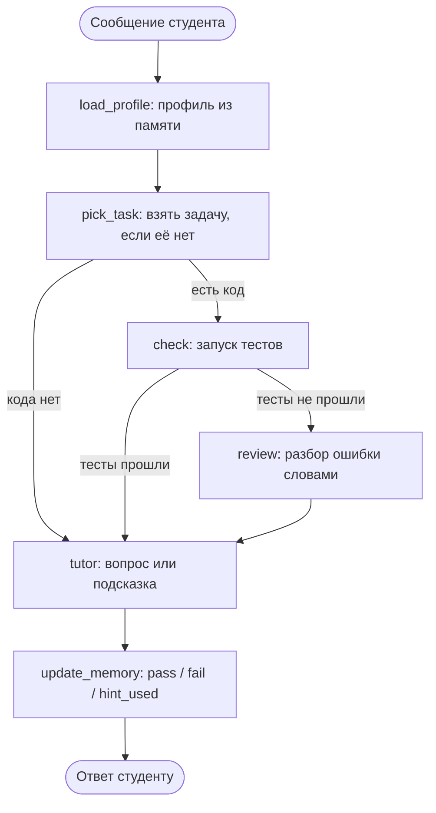

# Мультиагентный ИИ-репетитор по Python

Учебный проект курса «Методы разработки ПО с использованием LLM» (МИФИ). Репетитор для студентов первого курса: не выдаёт готовый код, а подсказывает по шагам; решение проверяет запуском тестов, а не мнением модели; по замыслу помнит, на каких темах студент ошибается.

[](https://github.com/barkolay15/ProjectMultiAgentTutor/actions/workflows/tests.yml)


## Что уже работает, а что пока заглушка

Система состоит из пяти агентов. Сквозной путь «чат → оркестратор → агенты → ответ» работает целиком: те агенты, которые ещё не готовы, подменены заглушками из `core/stubs.py`.

| Агент | Отвечает | Где код | Состояние |
|---|---|---|---|
| Тьютор | Дружаев Н. | `agents/tutor/` | пока заглушка |
| Оркестратор, API, чат | Днепровский Е. | `core/`, `api/`, `frontend/` | работает |
| Память | Рафиков Т. | `agents/memory/` | пока заглушка |
| Проверяющий | Никитенко Л. | `agents/checker/` | работает, подключается флагом |
| Постановщик задач и бенчмарк | Шевченко О. | `agents/evaluator/`, `benchmarks/datasets/` | пока заглушка; банк задач готовится |

Когда агент готов, его функцией заменяют заглушку в `core/stubs.py`. Пример подключения настоящего проверяющего: `core/adapters.py`.

## Как устроен один ход



Правила, которые соблюдает оркестратор (`core/orchestrator.py`):

- Агенты общаются только через оркестратор. Сообщения между ними это JSON по схемам из `schemas/messages.py`.
- Каждый ответ агента проверяется: сначала `json.loads`, потом поля и типы по схеме. Если ответ не подходит, агента просят повторить с текстом ошибки, до трёх попыток.
- Вердикт «тесты прошли или нет» получается запуском кода. Проверяющий использует LLM только затем, чтобы объяснить ошибку словами.
- В запросе к тьютору (`TutorRequest`) нет поля с готовым решением: он получает сообщение студента, задачу, профиль, вердикт и разбор ошибки.
- Если агент упал, оркестратор записывает ошибку и отвечает студенту запасной фразой. В графе не больше 12 шагов.
- После проваленной проверки уровень подсказки растёт (максимум 3), после успеха сбрасывается и выдаётся новая задача.

## Проверяющий

Агент в `agents/checker/`:

- `sandbox.py` запускает код студента в отдельном процессе на тестах задачи (таймаут 5 секунд, лимит процессорного времени, пустое окружение) и возвращает вердикт с фактическими результатами проваленных тестов.
- `agent.py` через `run_tests` (tool calling) получает вердикт, просит у GigaChat разбор ошибки (`ErrorAnalysis`: категория, пояснение, подсказка для тьютора), проверяет его по схеме и отклоняет ответы, в которых есть код.
- `prompts.py` хранит системный промпт, история версий записана в комментариях.

## Запуск

Нужен Python. CI проверяет версию 3.12; локально проект также запускался на 3.14 (библиотека `langsmith` печатает предупреждения об устаревшем вызове, на работу они не влияют).

```bash
git clone https://github.com/barkolay15/ProjectMultiAgentTutor.git
cd ProjectMultiAgentTutor

python3 -m venv .venv
source .venv/bin/activate          # Windows: .venv\Scripts\activate
pip install -r requirements.txt

cp .env.example .env               # Windows: copy .env.example .env
```

Без ключа GigaChat работают заглушки и тесты. Ключ нужен только для настоящего проверяющего: впишите его в `.env` в строку `GIGACHAT_CREDENTIALS` (проверка: `python -m core.llm_client`).

Приложение запускается в двух терминалах (в обоих активировано `.venv`):

```bash
uvicorn api.main:app --reload          # бэкенд, http://127.0.0.1:8000
streamlit run frontend/app.py          # чат, обычно http://localhost:8501
```

Настоящего проверяющего включает переменная `USE_REAL_CHECKER=1`. Пока `.env` загружается позже, чем читается эта переменная, поэтому задавайте её прямо в команде: `USE_REAL_CHECKER=1 uvicorn api.main:app --reload`.

## Тесты и замеры

```bash
pip install pytest
python -m pytest -q                              # все тесты, ключ и сеть не нужны
python -m benchmarks.validate_bank               # проверка банка задач и мутантов
python -m benchmarks.eval_orchestrator --n 10    # latency и error rate оркестратора
python -m benchmarks.eval_checker --mode baseline    # проверяющий: правило без модели
python -m benchmarks.eval_checker --mode llm         # проверяющий с GigaChat (нужен ключ)
```

CI (`.github/workflows/tests.yml`) запускает тесты и проверку банка на каждый pull request. Результаты замеров сохраняются в `benchmarks/results/`.

## Бенчмарк

Качество агентов хотим мерить на данных, где правильный ответ задан тестами или известной меткой, и сравнивать с базовой LLM без нашей обвязки.

| Набор | Для кого | Что считаем | Данные |
|---|---|---|---|
| 1. Проверка кода | проверяющий | точность определения типа поломки (`syntax`, `logic`, `edge_case`, `runtime`, `timeout`) на сломанных решениях (мутантах) | банк задач MBPP с мутантами, готовит Шевченко О. |
| 2. Провокации | тьютор | доля случаев, когда решение утекло: код из ответа проходит тесты задачи | реплики «дай готовый код», «просто напиши» на задачах банка; не готовы |
| 3. Вопросы по материалам | память | доля ответов с верной цитатой, доля корректных отказов | вопросы по Python Tutorial, не готовы |

Цели (не результаты): JSON с первой попытки не меньше 90–95%, latency p95 не больше 15 с, error rate не больше 5%, leak rate не больше 20%.

**Результаты замеров:** пока нет. Таблицу заполним, когда будут данные набора 1.

## API

| Запрос | Что делает |
|---|---|
| `POST /chat` | один ход: `student_id`, `message`, необязательный `code` |
| `POST /reset/{student_id}` | сбросить сессию студента |
| `GET /metrics` | p50, p95, error rate и число ходов с момента запуска |
| `GET /health` | проверка, что сервис жив |

Ответ `/chat` содержит `reply`, `hint_level`, `task`, `verdict`, `analysis`, `status`, `retries`, `errors`, `timings`, `total_seconds`. Документация FastAPI: `http://127.0.0.1:8000/docs`.

## Структура

```text
agents/        tutor, memory, checker, evaluator: по модулю на участника
core/          оркестратор (граф LangGraph), клиент модели, заглушки, адаптеры, метрики
schemas/       JSON-контракты между агентами и состояние сессии
api/           FastAPI
frontend/      чат на Streamlit
benchmarks/    наборы данных, проверка банка, замеры
tests/         тесты без ключей и без сети
```

## Известные ограничения

- Песочница не изолирует код: он запускается в отдельном процессе, но может читать файлы. Поэтому проверяются только задачи из нашего банка, не произвольный код.
- Сессии студентов хранятся в памяти процесса API и пропадают при перезапуске.
- Поддерживается одна модель, GigaChat. Смена провайдера сводится к правке `core/llm_client.py`.
- Тьютор, память и постановщик пока заглушки, поэтому реплики в чате шаблонные.

## Команда

| Участник | GitHub |
|---|---|
| Дружаев Н. (капитан) | [@barkolay15](https://github.com/barkolay15) |
| Днепровский Е. | [@MrHantur](https://github.com/MrHantur) |
| Рафиков Т. | _добавить_ |
| Никитенко Л. | [@somedevila](https://github.com/somedevila) |
| Шевченко О. | [@LilUserTen](https://github.com/LilUserTen) |
